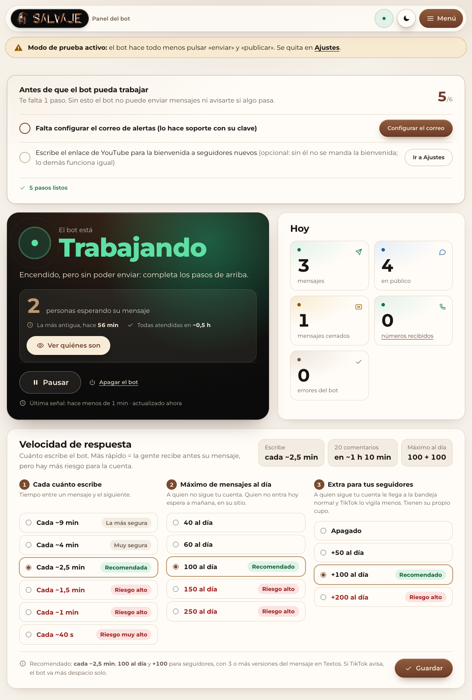
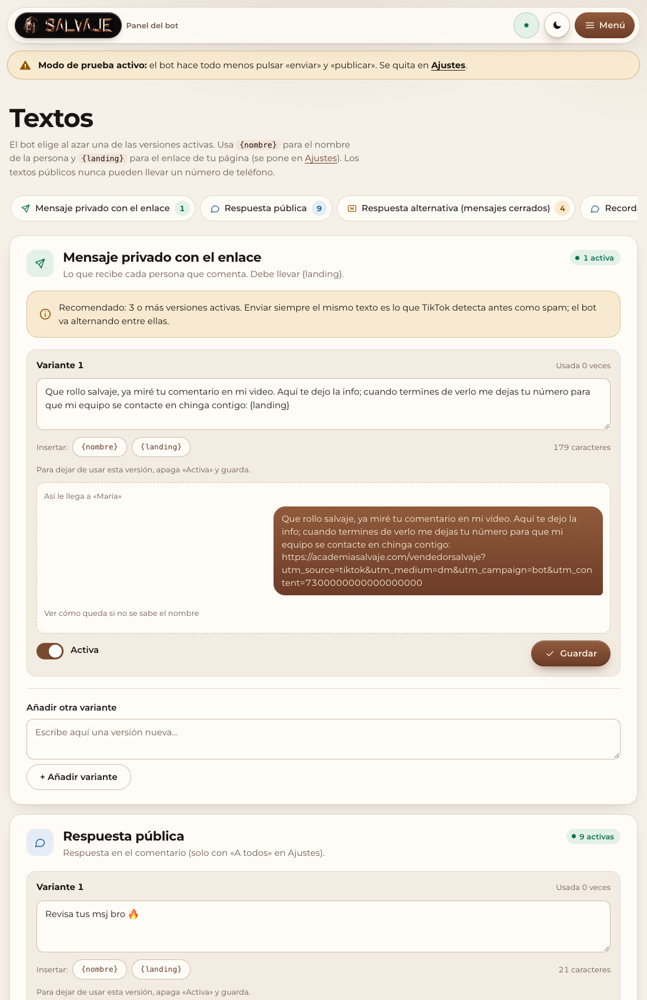
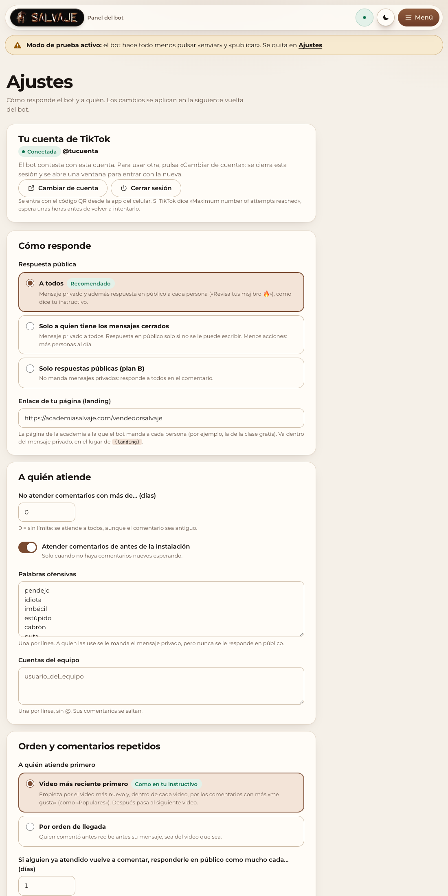
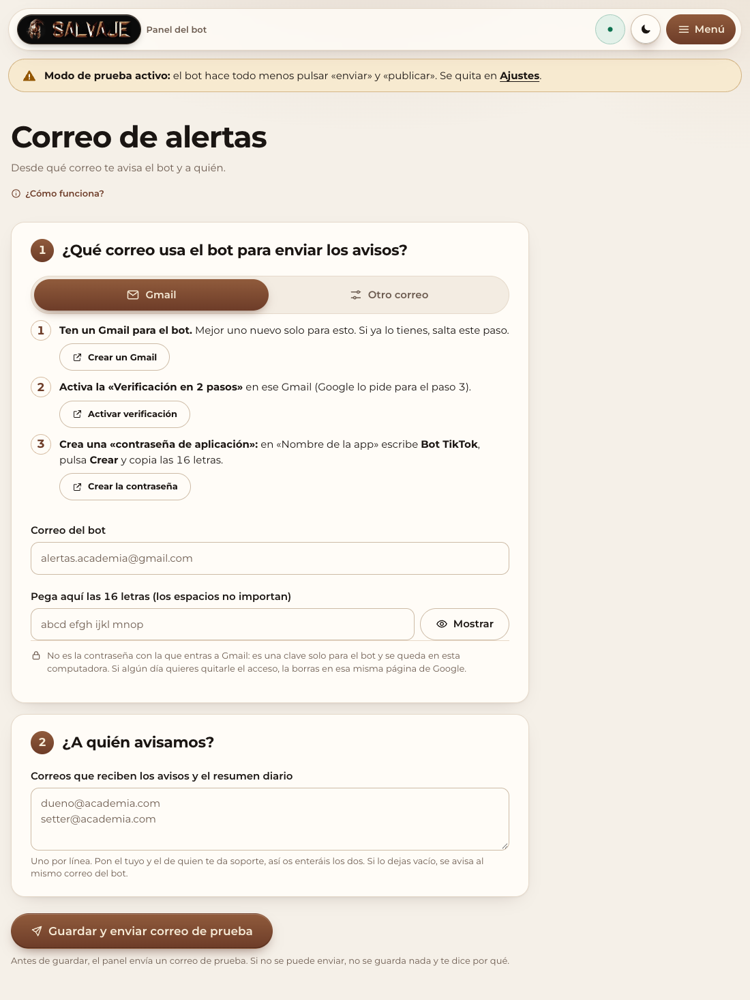
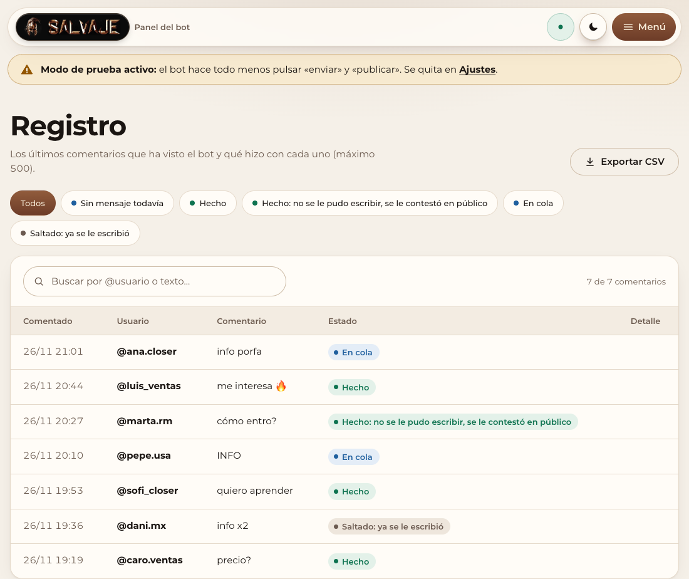

# Bot de TikTok: comentario → mensaje privado

Este programa funciona en tu computadora y usa tu cuenta de TikTok desde Google Chrome. Cada vez que alguien comenta en tus reels:

- le envía **un mensaje privado** con tu enlace y le responde **en público** («Revisa tus msj bro 🔥»). Por cada reel, una sola vez por persona aunque comente varias veces; si ya lo recibió y comenta en **otro reel** donde nunca había comentado, le llega otra vez (como mucho uno al día, y no si ya dejó su número);
- si esa persona tiene los mensajes cerrados, o TikTok no deja que le llegue el mensaje (pasa con algunas cuentas nuevas o con los mensajes limitados), le responde en público con otro texto («Tírame msj bro 🔥»); cuando la persona escribe, el bot le manda el enlace en esa conversación;
- si TikTok no deja pasar **3 mensajes privados seguidos**, el bot deja de intentarlos **24 horas** para cuidar la cuenta (cada intento alarga el bloqueo de TikTok): mientras tanto contesta en público invitando a escribir, te avisa por correo y lo verás en Inicio. Pasadas las 24 h prueba con uno; si llega, todo sigue normal;
- si ya tenía la info y vuelve a comentar en el mismo reel, le recuerda en público que revise sus mensajes (como mucho una vez al día);
- **lee tus mensajes privados**: si la persona deja su número, le contesta «Ya tenemos tu número…» y **te lo pasa** (correo al momento, página **Leads** y, si quieres, tu GoHighLevel); si pregunta o duda, le pide el número; si pregunta precios o se queja, **no le contesta y te avisa** para que le escriba alguien del equipo;
- cuando tu equipo marca en **Leads** «Ya hablé con la persona», le escribe «Que rollo bro, ¿cómo te fue?»;
- a cada **seguidor nuevo** le manda tu mensaje de bienvenida con el video de YouTube.

Los textos de tu instructivo ya vienen cargados; los puedes cambiar en **Textos**.

Trabaja a ritmo de persona: hace pausas, descansa y nunca hace dos cosas a la vez. Si TikTok muestra un aviso, un captcha o pide verificar la cuenta, **el bot se para y te avisa por email**. Nunca intenta saltarse esos controles.

**¿Y si subes varios reels el mismo día?** No hay que hacer nada. El bot lee los comentarios de **todos tus reels juntos** (la lista de comentarios de TikTok Studio): cada 3–5 minutos cuando hay movimiento (un reel publicado hace menos de 3 horas o comentarios en la última media hora) y cada 6–12 minutos cuando está tranquilo, así que un reel nuevo entra solo en cuanto alguien comenta. Todos los comentarios van a **una sola fila**. Como dice tu instructivo, se atiende primero el **video más reciente** y, dentro de cada video, los comentarios con **más «me gusta»** (como «Populares»); en *Ajustes* puedes cambiarlo a «por orden de llegada». Quien comenta en varios reels recibe **un solo mensaje**. Además, cada 12 horas el bot repasa toda la lista de comentarios por si se le escapó alguno. El enlace del mensaje lleva el número del reel, así que en tu landing ves qué reel trae a cada persona. Más reels no hacen que el bot vaya más rápido: el ritmo lo marca la **velocidad de respuesta** que eliges en *Inicio*. Si llegan muchos comentarios, la cola crece y en *Inicio* ves cuánto tardará en vaciarse.

---

## 1. Antes de empezar

- Una computadora **Mac o Windows** que pueda quedarse **encendida todo el día**, con internet. La pantalla se puede apagar; el bot no deja que la computadora entre en reposo.
- **El navegador del bot** lo pone el instalador: en Mac descarga «Google Chrome for Testing» (aparte de tu Chrome); en Windows usa Google Chrome y lo instala si falta.
- Tus textos: varias versiones del mensaje privado, de la respuesta pública y de la respuesta para mensajes cerrados, y la dirección de tu landing.

## 2. Instalar (una sola vez)

> ¿Tienes **Claude Code**? Puede instalarlo por ti: abre `INSTALAR-CON-CLAUDE-CODE.md` y sigue sus instrucciones.

1. Descarga el bot desde el enlace que te mandamos (si es una página de GitHub: botón verde **«Code» → «Download ZIP»**) y **descomprímelo** (Mac: doble clic sobre el .zip; Windows: clic derecho → **«Extraer todo…»** → **«Extraer»**). Puede quedarse en Descargas: el instalador copia el bot solo a una carpeta segura, porque esas carpetas se limpian o se sincronizan y el bot dejaría de funcionar:
   - Mac: `Aplicaciones › Bot TikTok`, dentro de tu usuario (`~/Applications/Bot TikTok`).
   - Windows: `%LOCALAPPDATA%\Programs\Bot TikTok`.

   Después de instalar puedes borrar el .zip y lo descomprimido.
2. En la carpeta descomprimida hay una carpeta para cada sistema: **`MAC`** y **`WINDOWS`**. Entra en la tuya y haz doble clic en **`INSTALAR`**:
   - **Mac:** `MAC › INSTALAR.command`. La primera vez el Mac dice que **no puede verificarlo** (es normal: el programa no viene de la App Store). Pulsa **«Listo»**, abre **Ajustes del Sistema → Privacidad y seguridad**, baja hasta el aviso de `INSTALAR.command` y pulsa **«Abrir igualmente»** (pide la contraseña del Mac). En Mac más antiguos basta con **clic derecho → Abrir → Abrir**. Solo pasa con el instalador: los demás botones de la carpeta `MAC` ya se abren sin aviso.

   En cada carpeta hay cuatro botones: **INSTALAR**, **INICIAR-SESION** (volver a conectar TikTok), **ACTUALIZAR** (lo usa soporte) y **DESINSTALAR**. Usa solo los de tu sistema.
   - **Windows:** `WINDOWS › INSTALAR.bat`. Si aparece «Windows protegió su PC», pulsa **Más información → Ejecutar de todas formas**. Si Windows pide permiso para instalar Google Chrome, acéptalo.
3. Espera a que termine (unos minutos). No hay que escribir nada.
4. Al terminar **se abre el panel en tu navegador**:
   - Te pide **crear una contraseña** para el panel. Elige una y apúntala.
   - Después te lleva a **Inicio**, que muestra la lista **«Antes de que el bot pueda trabajar»**: conectar tu cuenta de TikTok (sección 3), tus textos, el enlace de tu página y el **correo de alertas** (ver *Correo*).
   - El bot empieza en **modo de prueba**: hace todo menos enviar (ver *Inicio*).
5. En el Escritorio tendrás dos accesos directos: **«Panel del bot»** e **«Iniciar sesión del bot»**.

A partir de aquí el bot y el panel **arrancan solos** cada vez que enciendes la computadora e inicias sesión, y se vuelven a abrir solos si se cierran.

> Si algún día mueves la carpeta a otro sitio, vuelve a hacer doble clic en el instalador.
>
> Si algo falla, la ventana del instalador no se cierra sola: dice qué pasó. Haz una captura y envíala al soporte.

## 3. Conectar tu cuenta de TikTok (una sola vez)

El bot usa su **propio Chrome**, separado del tuyo. Tu Chrome personal no se toca y puedes usarlo a la vez que el bot. En Mac, el del bot se llama **«Google Chrome for Testing»** y tiene su propio icono en el Dock: ese es el del bot.

1. En el panel, pulsa **«Conectar mi cuenta»** (en Inicio, o en la página **Tu cuenta de TikTok**). Se abre una ventana de TikTok.
2. En la app de TikTok del celular, comprueba que está abierta **la cuenta que usará el bot**. En la ventana elige **«Usar código QR»** y escanéalo (Perfil → ☰ → icono de escanear).
3. Cuando veas tu cuenta dentro, vuelve al panel y pulsa **«Ya entré»**.
4. En un minuto, el panel muestra **«Conectada: @tucuenta»**. No hay que escribir la cuenta en ningún sitio: el bot la toma de la sesión.

Mientras no conectes la cuenta, el panel dice **«Falta conectar tu cuenta de TikTok»** y el bot no hace nada. En la misma página puedes **volver a iniciar sesión** (si TikTok la cierra) o **desconectar** la cuenta para poner otra. También sigue estando el acceso «Iniciar sesión del bot» en el Escritorio, que hace lo mismo desde una ventana de Terminal.

**Importante:**
- Inicia sesión **una sola vez** y sin repetir intentos. Si TikTok dice **«Maximum number of attempts reached»**, espera unas horas (como mucho un día) y vuelve a intentarlo **una vez**.
- No cierres ni uses la ventana de Chrome del bot mientras trabaja.

**La ventana del bot se abre minimizada.** Cuando el bot arranca, su Chrome se queda minimizado en el Dock (Mac, icono «Google Chrome for Testing») o en la barra de tareas (Windows) y trabaja igual. Puedes usar la computadora y tu propio Chrome con normalidad.
- Si quieres ver qué hace, haz clic en ese Chrome del Dock o de la barra de tareas. Mirar no le molesta; solo no escribas ni hagas clic dentro de la página.
- Puedes volver a minimizarla cuando quieras. **No la cierres**: si se cierra, el bot se vuelve a abrir solo en un minuto, pero pierde lo que estaba haciendo en ese momento.
- La pantalla se puede apagar. Lo que no puede es **dormirse la computadora**. En una laptop, **no cierres la tapa** (salvo que tenga un monitor conectado).

## 4. El panel

Abre **«Panel del bot»** (o ve a `http://127.0.0.1:8765` en tu navegador) y entra con tu contraseña. Solo funciona en esa computadora.

**Modo claro u oscuro:** el botón de arriba a la derecha (🌙 *Modo oscuro* / ☀️ *Modo claro*) cambia el panel con un clic, y el navegador lo recuerda. Si nunca lo pulsas, el panel usa el mismo modo que la computadora.

### Inicio



- **Estado:** *Trabajando*, *Descansando*, *En pausa*, *Frenado por TikTok* (con la hora a la que sigue), *Necesita a una persona*, *Sesión de TikTok cerrada* o *El bot no responde* (lleva más de 10 minutos sin dar señal de vida: la computadora está dormida o apagada, o el bot se cerró). Cada estado tiene su color y su icono, y debajo dice **qué tienes que hacer tú** (casi siempre, nada). La página se actualiza sola cada 20 segundos.
- **Antes de que el bot pueda trabajar:** mientras falte algo (el correo de alertas, la landing o algún texto necesario), Inicio muestra una lista con lo que falta y un botón para ir a cada sitio. Cuando está todo, desaparece.
- **Pausar / Reanudar:** para el bot **un rato** (sigue abierto, con su ventana de Chrome) o lo pone en marcha. «Reanudar» también es el botón que hay que pulsar después de resolver un captcha o de volver a iniciar sesión.
- **Apagar el bot / Encender:** «Apagar el bot» (debajo de Pausar, pide confirmación) lo apaga **del todo**: cierra su ventana de Chrome, deja de escribir y la computadora ya puede dormir. **Sigue apagado aunque reinicies la computadora.** Los comentarios nuevos se quedan esperando y se atienden al pulsar **«Encender»**. El panel sigue disponible para volver a encenderlo. No cierres la ventana de Chrome del bot a mano para apagarlo: el sistema la vuelve a abrir.
- **Avisos:** si TikTok no está dejando pasar los mensajes privados («Mensajes privados en pausa hasta…») o si **no te están llegando los correos de aviso** (con el motivo y un enlace para revisar el correo).
- **Cola:** cuántos comentarios esperan, cuánto lleva esperando el más antiguo y cuánto se tardaría en atenderlos.
- **Velocidad de respuesta:** eliges cada cuánto envía el bot un mensaje: cada ~9 min, ~4 min, **~2,5 min (recomendada, con la que empieza)**, ~1,5 min, ~1 min o ~40 s. Debajo de cada una ves cuánto tardaría en atender a 20 personas. Las tres más rápidas están en rojo: pueden hacer que TikTok frene o bloquee la cuenta, y para guardarlas hay que marcar «Entiendo el riesgo». Si TikTok avisa, el bot va más despacio solo.
- **Máximo de mensajes privados al día:** 40, 60, **100 (recomendado, con el que empieza)**, 150 o 250. Quien no entra hoy queda en la cola para mañana. Por encima de 100 está en rojo y hay que marcar «Entiendo el riesgo»: lo que más vigila TikTok es el total de mensajes al día a gente que no te sigue.
- **Además, a quien sigue tu cuenta:** Apagado, +50, **+100 (recomendado, con el que empieza)** o +200 (rojo). Son mensajes extra al día solo para quien sigue tu cuenta: les llega a la bandeja normal (no a «Solicitudes») y TikTok los vigila menos. El bot lo sabe al abrir el perfil de la persona, justo antes de escribirle. Si el cupo general se llena, sigue escribiendo a los seguidores y deja a los demás **en su sitio** de la cola para el día siguiente; para saber quién sigue la cuenta mira perfiles al mismo ritmo elegido.
- **Textos:** escribe **3 o más versiones** de cada mensaje. El bot las va alternando; mandar siempre el mismo texto es lo que TikTok detecta antes como spam.

Si arriba ves la franja amarilla **«Modo de prueba activo»**, el bot hace todo menos pulsar «enviar» y «publicar». Se desactiva en *Ajustes*. Al quitarlo, las personas atendidas durante la prueba vuelven a la cola y reciben su mensaje de verdad (nadie se queda sin él).

### Textos



- Públicos (en los comentarios): **respuesta pública**, **respuesta alternativa** (mensajes cerrados, o TikTok no dejó que le llegara el privado), **recordatorio** (ya tenía la info y vuelve a comentar), **ya estamos en contacto** (ya dejó su número) y **comentario fijado**. Nunca pueden llevar un número de teléfono.
- Privados: **mensaje con el enlace**, **cuando deja su número**, **cuando pregunta o duda**, **ánimo** (cuando se muestra interesado), **seguimiento** (`{vendedor}` = quien habló con la persona) y **bienvenida** (`{youtube}` = tu video de YouTube).
- Escribe **varias versiones** de cada uno; el bot va alternándolas.
- Puedes usar `{nombre}` (el nombre de la persona; si no se sabe, se quita solo) y `{landing}` (tu landing, con el seguimiento de qué reel trae a cada persona).
- Debajo de cada texto ves cómo quedará. Apaga el interruptor **«Activa»** para dejar de usar una versión sin borrarla, y pulsa **«Guardar»**.

### Ajustes



- **Respuesta pública:**
  - *Solo a quien tiene los mensajes cerrados* (recomendado): un mensaje privado a cada persona; respuesta pública solo si no se le puede escribir. Además, en cada reel nuevo **publicas tú y fijas** un comentario (por ejemplo «¿Quieres info? Escríbenos por mensaje»): desde la app tarda unos segundos. El bot no lo hace porque abrir la página del vídeo hace que TikTok pida captchas.
  - *A todos*: mensaje privado **y** respuesta pública a cada persona. Gasta más acciones, así que se atiende a menos gente al día.
  - *Solo respuestas públicas*: sin mensajes privados. Úsalo solo si TikTok te limita los mensajes.
- **Enlace de tu página (landing)**: la página de la academia a la que el bot manda a cada persona (por ejemplo, la de la clase gratis). **Palabras ofensivas** (esas personas reciben el mensaje privado pero nunca una respuesta pública) y **cuentas del equipo** (sus comentarios se ignoran).

### Correo



Aquí eliges **desde qué correo** te escribe el bot y **a quién** avisa. Lo configuras tú y lo puedes cambiar cuando quieras (por ejemplo, para añadir otro correo que reciba los avisos). Una vez hecho, la página muestra desde qué correo envía, a quién avisa y un botón **«Enviar correo de prueba»** para comprobar cuando quieras que los avisos llegan.

Pasos (la página te lleva de la mano, con un botón para cada paso en Google):

1. **Ten un Gmail para el bot** (mejor uno nuevo solo para esto, por ejemplo `alertas.academia@gmail.com`).
2. **Activa la «Verificación en 2 pasos»** en ese Gmail.
3. **Crea una «contraseña de aplicación»** (16 letras) y pégala en la página. No es la contraseña con la que entras a Gmail.
4. Escribe **a quién avisar** (uno por línea): tú y quien te da soporte. Si lo dejas vacío, avisa al mismo correo del bot.
5. Pulsa **«Guardar y enviar correo de prueba»**. Si todo está bien, llega un correo de prueba (si no se ve, mirar en Spam). Si algo falla, no se guarda nada y la página dice qué corregir. Si Gmail rechaza la contraseña, casi siempre es que la contraseña de aplicación se creó en **otra** cuenta de Google.

Para cambiarlo después, pulsa **«Cambiar»**: la contraseña guardada se mantiene si no cambias de correo.

Si en **Inicio** ves el aviso rojo **«Falta configurar el correo de alertas»**, es que todavía no está hecho.

- **Orden y comentarios repetidos**: video más reciente primero (como tu instructivo) o por orden de llegada; cada cuántos días, como mucho, se le responde en público a quien vuelve a comentar.
- **Conversación por mensaje privado**: encender o apagar la lectura de mensajes, **palabras que pasan la conversación a tu equipo** (precio, queja…), palabras de interés y cuántas respuestas automáticas como mucho por persona.
- **Leads**: correos que reciben cada número y, si usas GoHighLevel, el enlace de su «Inbound Webhook» para que cada lead entre solo. Horas de espera antes del «¿cómo te fue?».
- **Bienvenida a seguidores nuevos**: encenderla y el enlace del video de YouTube (sin enlace no se manda).

### Leads

- Cada persona que dejó su número: cuándo, su @, el número (con botón **«Abrir en WhatsApp»**), de qué video vino y su palabra clave. Se descarga para Excel.
- Cuando alguien del equipo hable con ella, escribe quién fue (opcional) y pulsa **«Ya hablé con la persona»**: el bot le escribirá el seguimiento.
- Arriba salen las personas que **esperan que alguien del equipo les conteste** (preguntaron precios, se quejaron…). Contéstales desde la app de TikTok y pulsa «Ya le contesté», o «Que la atienda el bot» para que vuelva a contestarle él.

### Registro y Reels



- **Registro:** los últimos 500 comentarios y qué se hizo con cada uno. Puedes filtrar por estado, **buscar** por @usuario o texto y **exportar a CSV** (se abre con Excel).
- **«Enviar mensaje privado ahora»:** sale en cada persona a la que no le llegó el mensaje privado (TikTok no lo dejó pasar, tenía los mensajes cerrados o solo se le contestó en público). Al pulsarlo, el bot le manda **en unos segundos** el mensaje privado de *Textos* (sin esperar su turno) y la fila dice cómo fue: enviado, o que TikTok tampoco lo dejó pasar. Si el bot está en pausa o frenado, sale cuando vuelva a trabajar. Úsalo con cabeza: cada intento que TikTok rechaza puede alargar su bloqueo.
- **Reels:** los reels que el bot vigila y la **palabra clave** de cada uno (sale sola del texto del video, «Comenta "VENTAS"…»; la puedes cambiar). El bot responde a todos los comentarios igual: la palabra solo sirve para saber de qué video vino cada lead. Cuando fijes el comentario en uno, pulsa «Ya lo fijé» para llevar la cuenta.

## 5. Los emails del bot

Todos llegan de **«Bot de TikTok»** y el asunto empieza con un color, para encontrarlos de un vistazo entre muchos correos:

- 🔴 **Te necesita:** tienes que hacer algo (el correo dice qué, paso a paso).
- 🟠 **Avisa a soporte.**
- 🟡 **Solo para que lo sepas:** se arregla solo.
- 📊 **Resumen** de cada mañana.

| Asunto (empieza por «Bot de TikTok ·») | Qué significa | Qué hacer |
|---|---|---|
| 📊 **Ayer: N mensajes y N respuestas** (9:00 a. m., hora de Utah) | Lo que hizo ayer y cómo está la cola. | Nada. **Si una mañana no llega**, la computadora o el bot están apagados. |
| 🟡 **Frenado por TikTok, vuelve solo…** | TikTok avisó de ir rápido. El bot baja el ritmo y espera 24 h (48 h si se repite). | Nada; vuelve solo. Si soporte ve en la captura que TikTok no avisó de nada (falsa alarma), lo quita con **«Quitar el freno (solo soporte)»** y su clave (ver *Para desarrollo*). |
| 🟡 **TikTok no deja pasar los mensajes privados: pausa de 24 h** | TikTok rechazó 3 privados seguidos. Durante 24 h el bot solo contesta en público (invitando a escribir) y a quien escribe le manda el enlace. | Nada. Si llega varios días seguidos, avisa a soporte. |
| 🟡 **Pausa de 30 min por errores** | Falló varias veces seguidas y descansa. | Nada. Si llegan varios el mismo día, avisa a soporte. |
| 🟡 **N personas esperan respuesta** | Entran más comentarios de los que se pueden atender. | Opcional: elegir una velocidad más rápida en *Inicio* (más riesgo) o limitar los días de antigüedad en *Ajustes*. |
| 🔴 **Te necesita: TikTok pide un captcha / verificar la cuenta** | El bot no lo resuelve solo. | Abre la ventana de Chrome del bot, resuélvelo tú y pulsa **Reanudar** en el panel. |
| 🔴 **Te necesita: vuelve a iniciar sesión en TikTok** | TikTok cerró la sesión del bot. | En el panel, **Tu cuenta de TikTok → «Volver a iniciar sesión»** (sección 3), una sola vez con QR, y después **Reanudar**. |
| 🔴 **Te necesita: TikTok avisó 3 veces esta semana** | Demasiados avisos seguidos. | Habla con soporte antes de pulsar **Reanudar**. |
| 🔴 **Te necesita: falla una y otra vez** | Puede que TikTok haya cambiado su página. | Avisa a soporte y no pulses **Reanudar** hasta que te lo digan. |
| 🔴 **Te necesita: falta configurar algo en el panel** | Por ejemplo, no hay textos o falta el enlace de tu página. | Abre el panel: en Inicio está la lista de lo que falta. |
| 🔴 **No responde desde hace N min** | El bot no da señales de vida. | Comprueba que la computadora está encendida, despierta y con internet, y que Chrome del bot sigue abierto. Si no se arregla, reiníciala. |
| 🟠 **La revisión diaria de pantallas falló** | TikTok cambió algo en su página. | Avisa a soporte. |

Al final de algunos correos hay un «Detalle técnico (para soporte)»: no hace falta entenderlo, solo reenviarlo si soporte lo pide.

## 6. Reglas para que la cuenta esté tranquila

- **Mientras el bot esté encendido, nadie responde comentarios ni manda mensajes a mano desde la cuenta.** Atended solo los mensajes que llegan (o que lo haga ManyChat). TikTok también cuenta lo que se hace a mano.
- No uses ni cierres la ventana de Chrome del bot (minimizada está bien).
- Desactiva otras respuestas automáticas a comentarios (por ejemplo, GoHighLevel) para que nadie reciba dos mensajes.
- El bot lee los mensajes que llegan: a quien escribe le manda el enlace o le pide su número, y los números quedan en **Leads**. Quien pregunta algo que el bot no sabe contestar aparece en Leads para que lo atienda alguien del equipo.
- **Los primeros días, ve despacio:** la primera semana usa ~4 min y después sube a la recomendada (~2,5 min). No empieces en las rojas. El primer día, pide a 3–5 personas del equipo que comenten un reel y comprueba que les llega el mensaje privado.
- Usa la cuenta con normalidad (sube reels como siempre). Un mensaje privado corto y natural, sin muchos emojis, pasa mejor que uno largo de venta.

## 7. Actualizar (lo hace el soporte)

1. Se copia la versión nueva **en una carpeta nueva**, al lado de la actual. La anterior no se toca.
2. En la carpeta nueva, haz doble clic en `MAC › ACTUALIZAR` o `WINDOWS › ACTUALIZAR`. Hace una copia de seguridad de los datos, actualiza y vuelve a arrancar el bot con la versión nueva.
3. **Para volver atrás:** desde la carpeta anterior, `scripts/actualizar.command` o `scripts\actualizar.bat` con `--restaurar "<copia>"`. La ruta exacta de la copia aparece al terminar la actualización.

Tus datos (comentarios, textos, ajustes, sesión de TikTok) no están en esta carpeta, sino aquí:

- Mac: `~/Library/Application Support/BotTikTok`
- Windows: `%LOCALAPPDATA%\BotTikTok`

Las copias de seguridad están dentro, en `copias/`.

## 8. Desinstalar

1. Abre la carpeta del bot (Mac: `Aplicaciones › Bot TikTok › BOT-TIKTOK-APP-…`; Windows: `%LOCALAPPDATA%\Programs\Bot TikTok\BOT-TIKTOK-APP-…`; en los dos, la más reciente).
2. Doble clic en `MAC › DESINSTALAR` o `WINDOWS › DESINSTALAR`.
3. Pregunta si quieres **apartar tus datos**:
   - **No** (lo normal): los datos se quedan donde están. Si vuelves a instalar, el bot sigue como estaba (misma cuenta, textos y ajustes).
   - **Sí**: la carpeta de datos se renombra a `BotTikTok-desinstalado-<fecha>` (**no se borra nada**). Una instalación nueva empieza vacía. Para recuperarlos, devuélvele el nombre `BotTikTok` antes de instalar.
4. El bot y el panel se paran, ya no arrancan solos y desaparecen los accesos directos del Escritorio. Después puedes llevar la carpeta del programa a la papelera.

## 9. Acceso remoto para soporte (AnyDesk)

1. Descarga AnyDesk desde **anydesk.com** e instálalo.
2. Cuando el soporte te lo pida, abre AnyDesk y dicta el número de **«Este escritorio»**.
3. Acepta la conexión cuando aparezca el aviso. Puedes cortarla cuando quieras cerrando AnyDesk.
4. No compartas ese número con nadie más.

## 10. Problemas frecuentes

- **El panel no abre:** reinicia la computadora (el panel arranca solo). Si sigue igual, avisa al soporte.
- **Olvidaste la contraseña del panel:** avisa al soporte. La contraseña no se puede leer (en el archivo `.env` de la carpeta de datos solo hay un resumen cifrado): soporte borra la línea `PANEL_CONTRASENA=` y, al abrir el panel, pide crear una nueva. Los textos, ajustes y la cuenta de TikTok no se tocan.
- **El panel vuelve a pedir la contraseña:** pasa cada 30 días o después de pulsar «Salir» (al final de Ajustes). Es normal.
- **No llegan los emails:** revisa la carpeta de spam. En el panel, en **Correo**, pulsa otra vez **«Guardar y enviar correo de prueba»**: si algo falla, te dice qué es.

---

## Para desarrollo

Requisitos: [uv](https://docs.astral.sh/uv/) y Google Chrome.

```bash
uv sync                               # Python 3.12 y dependencias exactas (uv.lock)
uv run pytest                         # tests
uv run python -m bot --help           # órdenes: iniciar-sesion, panel, instalar, desinstalar, actualizar
uv run python -m bot instalar --solo-mostrar
uv run python scripts/probar_alertas.py tu@email.com   # envía las 5 alertas de prueba (SMTP del .env)
uv run python -m bot clave-soporte    # crea o cambia la clave de soporte que pide «Quitar el freno»
```

Variable `BOT_TIKTOK_DATOS` para usar otra carpeta de datos (tests). El código no guarda nada dentro de esta carpeta.
